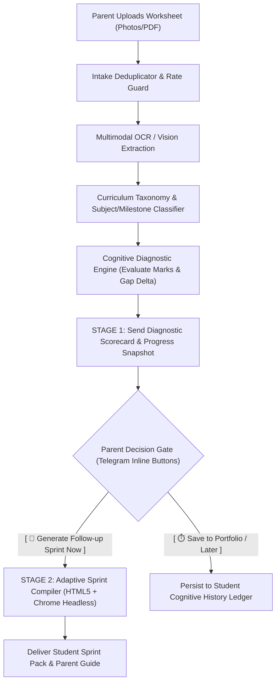

# ADR-003: Ingestion Pipeline Workflow, Curriculum SSOT Taxonomy, Assessment Entity Typology, and Deferred On-Demand Sprint Gating

**Status:** Accepted  
**Date:** 2026-10-26  
**Deciders:** Core Engineering Team, Pedagogical Architecture, System Security  
**Supersedes / Extends:** Extends [ADR-001 (Student Resource Hierarchy)](file:///home/kellyb_dev/projects/hex-aim/docs/ADR-001-STUDENT-RESOURCE-HIERARCHY-AND-MIGRATION.md) and [ADR-002 (Decoupled Student Identity)](file:///home/kellyb_dev/projects/hex-aim/docs/ADR-002-DECOUPLED-STUDENT-IDENTITY-AND-DYNAMIC-HYDRATION.md)

---

## 1. Context & Problem Statement

In the initial implementation of HEX-AIM, assessment worksheet ingestion suffered from four architectural flaws:

1. **Premature Sprint Generation ("Sprint Firehose")**:
   Uploading a worksheet immediately triggered `processAssessmentJob`, which compiled and delivered a 4-page student sprint PDF and parent coaching guide. Parents upload material for two distinct reasons:
   - **Cognitive Diagnostic Tracking & Progress Insights**: Immediate snapshot of marks, misconceptions, and learning trends.
   - **Targeted Remediation Sprints**: Practice sessions to fix gaps. Automatically spitting out PDFs every time creates cognitive clutter, delivers unneeded homework, and incurs redundant LLM and rendering costs.

2. **Hardcoded Ad-Hoc Curriculum & Student Logic**:
   Multimodal vision prompts, fallback classifiers, and worker jobs hardcoded binary student choices ("Lara" vs "Maya"), single schools ("Asten College"), and fractured subject/week defaults (English Week 3 vs Science Week 8). When science revision sheets were uploaded, the vision model was constrained to `'english' | 'maths'` and classified the science test as English.

3. **Missing Canonical Entity Taxonomy**:
   The system lacked formal domain entities and enums for assessment modalities (e.g. weekly quiz vs midterm exam vs practice run vs homework check).

4. **Decoupling Gaps**:
   Student primary keys and storage paths contained plaintext names, violating ADR-002 isolation principles.

---

## 2. Decision & Architectural Specifications

### 2.1 Two-Stage Ingestion Pipeline & On-Demand Sprint Gating

The ingestion pipeline is strictly decoupled into two deterministic stages:



#### Stage 1: Diagnostic Brief & Progress Snapshot (Immediate)
Upon uploading an assessment:
1. Extract handwritten answers, question concepts, and teacher marks.
2. Match against curriculum subject and milestone domains.
3. Update the child's anonymous cognitive gap ledger.
4. Deliver an immediate, formatted Telegram message containing:
   - **Header**: School, Subject, Assessment Modality, Date/Week.
   - **Scorecard**: Monospaced score table (`Marks: X/Y (Z%)`, Passing status).
   - **Misconception Deep-Dive**: Identified error classes and cognitive factors.
   - **Progress Trend**: Delta compared to previous assessments (+5%, new mastery).
   - **Interactive Action Gate**: Two inline buttons:
     - `[ 🚀 Generate Follow-up Sprint Now ]` (`callback_data: sprint:generate:{studentUid}:{assessmentId}`)
     - `[ ⏱️ Save to Portfolio / Later ]` (`callback_data: sprint:defer:{studentUid}:{assessmentId}`)

#### Stage 2: On-Demand Sprint Compilation (Deferred)
PDF generation (using modern HTML5/CSS3 and Chrome Headless) is executed **only when explicitly commanded by the parent** or triggered via scheduled routine (e.g. breakfast/evening review).

---

### 2.2 Canonical Assessment Entity Typology

All assessments processed by HEX-AIM are classified into strict domain entity types:

```typescript
export type AssessmentType =
  | 'weekly_quiz'           // Standard weekly formative classroom check
  | 'unit_test'             // End-of-unit summative assessment
  | 'midterm_exam'          // Midterm examination milestone
  | 'practice_run'          // Student-completed remediation sprint or revision sheet
  | 'revision_sprint'       // Rapid revision / targeted review
  | 'diagnostic_binder'     // Comprehensive multi-unit baseline diagnostic
  | 'homework_assignment';  // Take-home assisted worksheet (SOS review only)

export type MilestoneType =
  | 'weekly_formative'
  | 'midterm_summative'
  | 'end_of_unit_summative'
  | 'end_of_year_exam'
  | 'targeted_remediation';
```

---

### 2.3 Single Source of Truth (SSOT) Curriculum Taxonomy

The single source of truth for all curriculum subjects, domains, and terminology is the school curriculum exhibit located at:
`manifest/{school_id}_curriculum.json` (e.g. [`manifest/asten_college_curriculum.json`](file:///home/kellyb_dev/projects/hex-aim/manifest/asten_college_curriculum.json)).

#### Dynamic Subject Registry:
- `maths`: Mathematics (Number and Place Value, Addition/Subtraction, Multiplication/Division, Fractions/Decimals, Measurement, Geometry, Statistics).
- `english`: English Language & Literacy (Reading Comprehension, Writing Composition, SPaG).
- `science`: Science (Living Things & Habitats, States of Matter, Sound & Vibration, Electricity & Circuits).
- `humanities`: Humanities (History, Geography).
- `arabic`: Arabic Language (القراءة والفهم, النحو والقواعد, الإملاء والخط).
- `religion`: Religious Education (التربية الدينية - Islamic / Christian).
- `social_studies_ar`: Arabic Social Studies (الدراسات الاجتماعية).
- `foreign_language`: Second Foreign Language (French / German).

#### Fast Keyword Extraction Engine (`CurriculumTaxonomyService`)
Each subject maintains an indexed dictionary of 50–100 defining terms derived directly from curriculum exhibits. The taxonomy service provides:
1. Fast text/regex subject classification (<1ms) based on keyword frequency density.
2. Dynamic prompt injection for Multimodal Vision models (OpenRouter / Gemini), eliminating hardcoded subject enums.
3. Schema-guided validation using strict Zod runtime schemas.

---

### 2.4 Decoupled Privacy & Storage (ADR-002 Enforcement)

1. **Anonymous Student Identifiers**: All internal domain logic, storage keys, and job payloads operate exclusively on `studentUid` (`stu_<ulid>`).
2. **PII Isolation**: Child legal names and parent details are stored in isolated encrypted token vaults, never committed to git or embedded in Redis keys.
3. **Egress Hydration**: Child friendly names (`Lara`, `Maya`) and parent salutations (`Dad`) are attached dynamically at the presentation egress boundary only.

---

## 3. Consequences

### Positive:
- **Zero Premature PDF Bloat**: Parents receive immediate diagnostic scorecards; sprints are generated on demand.
- **Elimination of Classification Errors**: Science, Arabic, Maths, and English are dynamically loaded from SSOT.
- **Resource & Cost Efficiency**: Prevents redundant Chrome rendering and LLM calls when parents only require diagnostic tracking.
- **GDPR & Privacy Compliance**: Clean decoupling of cognitive models from child PII.

### Negative / Trade-Offs:
- Requires parents to press a Telegram button to trigger sprint PDF generation (can be overridden via setting `sprint.auto_generate: true` if an account prefers automatic delivery).

---

## 4. Implementation Schedule

1. **Core**: Introduce `CurriculumTaxonomyService` and canonical Zod contracts in `@hex-aim/core`.
2. **Adapters**: Update `OpenRouterVisionAdapter` and `GeminiVisionAdapter` to use dynamic taxonomy schemas.
3. **Bot**: Implement Two-Stage Scorecard & Gating callback handlers in `processAssessmentJob` and `worker.ts`.
4. **Verification**: Full test suite verification across all packages.
