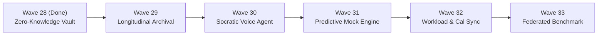

# HEX-AIM: Next 5 Waves Architectural Specification (Waves 29 – 33)

This specification defines the strategic, architectural, and pedagogical roadmap for **Waves 29 through 33**, completing the transformation of HEX-AIM into a closed-loop enterprise cognitive acceleration platform for UK British Curriculum primary students (Year 3–6).

---

## Strategic Horizon Overview

---

## Wave 29: Longitudinal Assessment Archival & Audit Dossier Engine (ADR-005)

### 1. Pedagogical Intent
Consolidates months of weekly micro-sprints and scanned assessments into tamper-evident, verifiable end-of-term student dossiers. Provides parents and schools with longitudinal growth curves, mastery delta trajectories, and standardized UK National Curriculum diagnostic benchmarks for parent-teacher conferences and SENCO reviews.

### 2. ADHD / Sensory Adaptation
Transforms fragmented anxiety-inducing scores into visual celebration milestones (mastered domains, zero-alarm victories, retention streaks). Protects working memory by summarizing historical cognitive trajectories in high-contrast visual infographics rather than dense grade tables.

### 3. Technical Architecture & Moats
- **Cryptographic Evidence Chain**: SHA-256 verifiable portfolio packager binding scanned images, OCR extracted text, Socratic hints, and graded mastery vectors.
- **Tiered Cold Storage**: Automated archival offloading from Upstash Redis hot keys to Cloudflare R2 / S3 cold buckets with pre-signed ephemeral download URLs (~1h TTL).
- **Multi-Page Vector Summary**: Generates 6-page A4 end-of-term summary PDF using Warm Browser Pool (<150ms latency) containing radar trends, subject breakdowns, and next-term intervention recommendations.

### 4. Implementation Deliverables
- `packages/core/src/archival/AssessmentArchiveEngine.ts`
- `packages/core/test/assessmentArchive.test.ts`
- Web Console: Tab 4 "Export Term 1 Cryptographic Dossier (PDF/ZIP)" modal.

---

## Wave 30: Real-Time Socratic Voice Dialogue & Oral Tutoring Agent

### 1. Pedagogical Intent
Enables low-friction, screen-free oral tutoring where the student or parent engages in direct two-way spoken Socratic dialogue with AIM. Converts passive reading into active vocal retrieval, which deepens long-term conceptual retention.

### 2. ADHD / Sensory Adaptation
Zero reading/screen fatigue. Specifically engineered for children with ADHD and Dyslexia traits who excel verbally but struggle with dense printed text. Built-in 3-minute spoken drill pacing with calm audio cues and zero-alarm praise feedback.

### 3. Technical Architecture & Moats
- **Low-Latency Audio Pipeline**: Client-side audio capture via Web Audio API, streamed directly to OpenRouter STT (`openai/gpt-4o-transcribe` / Whisper Turbo) with VAD (Voice Activity Detection).
- **Egyptian Arabic & English Dual Dialects**: Native support for Egyptian colloquial Arabic dialogue alongside English British Curriculum terminology.
- **Visual Waveform Oscilloscope**: Canvas-based real-time rotating scope-ring visualizer matching the Meta Astryx design language.

### 4. Implementation Deliverables
- `packages/core/src/voice/SocraticVoiceEngine.ts`
- `apps/web/src/ui/components/voiceDialogueModal.ts`
- `packages/core/test/socraticVoice.test.ts`

---

## Wave 31: Predictive Exam Readiness & Generative Mock Builder

### 1. Pedagogical Intent
Synthesizes personalized mock examination papers that mathematically target each student's active cognitive error clusters (`ERR_PHANTOM_ZERO`, `ERR_COLUMN_DRIFT`) and items approaching their cognitive decay half-life threshold ($R(t) < 0.75$).

### 2. ADHD / Sensory Adaptation
Predicts exam anxiety spikes before school test days. Generates calibrated, low-stakes practice drills with graduated question difficulty (starting with high-confidence wins, then scaffolding challenging multi-step questions) to cultivate psychological safety.

### 3. Technical Architecture & Moats
- **Isomorphic Question Synthesizer**: Generates novel question stems structurally equivalent to canonical exam boards (GL Assessment, Cambridge Primary, Edexcel) while altering contextual parameters to prevent superficial memorization.
- **Auto-Derived Rubric Vector**: Produces automated multi-tier mark schemes with partial-credit allocation rules and sensory scaffold suggestions.

### 4. Implementation Deliverables
- `packages/core/src/simulation/GenerativeMockEngine.ts`
- `apps/web/src/ui/examBuilderHtml.ts` (Dynamic `/exam/builder` route)
- `packages/core/test/generativeMock.test.ts`

---

## Wave 32: Intelligent Homework Balancer & Calendar Integration

### 1. Pedagogical Intent
Prevents academic burnout and cognitive overload by dynamically scheduling 8-minute micro-sprints around the family's real-world timetable, school assignment deadlines, and extracurricular sports/activities.

### 2. ADHD / Sensory Adaptation
Executive functioning prosthetic: breaks overwhelming weekly homework packets into manageable daily micro-sessions with calm, gentle reminders that eliminate domestic friction between parents and children.

### 3. Technical Architecture & Moats
- **Bi-Directional Calendar Engine**: Standard iCalendar (`.ics`) feed generation compatible with Apple Calendar, Google Calendar, and Microsoft Outlook.
- **Cognitive Load Leveling**: Heuristic scheduler preventing consecutive high-friction subjects (e.g. staggering Column Subtraction after a high-mastery verbal Science sprint).

### 4. Implementation Deliverables
- `packages/core/src/calendar/WorkloadBalancerEngine.ts`
- `apps/web/src/server.ts` (`/api/calendar/:studentId/feed.ics` endpoint)
- `packages/core/test/workloadBalancer.test.ts`

---

## Wave 33: Multi-School Federated Benchmark & Anonymized Cohort Exchange

### 1. Pedagogical Intent
Allows British Curriculum institutions in Cairo (Asten College, BISC, NCBIS, Cairo English School) to benchmark cohort mastery and error class distributions against peer schools without disclosing confidential institutional or student data.

### 2. ADHD / Sensory Adaptation
Destigmatizes neurodiverse learning needs by proving that sensory accommodation requirements (e.g. ADHD visual chunking, dyslexia room partitions) are widespread across top-performing cohorts.

### 3. Technical Architecture & Moats
- **Zero-Knowledge Differential Privacy**: Perturbs cohort averages using Laplace noise $\epsilon$-differential privacy, guaranteeing zero reconstruction of individual student performance.
- **Topological Mastery Comparison**: Ranks school cohort progress by curriculum graph depth rather than simplistic raw exam score percentages.

### 4. Implementation Deliverables
- `packages/core/src/institutional/FederatedBenchmarkEngine.ts`
- `apps/web/src/ui/teacherPortalHtml.ts` (Integrated "National Benchmark" tab)
- `packages/core/test/federatedBenchmark.test.ts`

---

## Dimension Comparison Matrix

## Comprehensive Transposed Multi-Dimensional Comparison Matrix (Waves 29 – 33)

| Dimension | Wave 29: Longitudinal Archival & Audit Dossier (ADR-005) | Wave 30: Real-Time Socratic Voice Dialogue & Oral Tutoring | Wave 31: Predictive Exam Readiness & Generative Mock Builder | Wave 32: Intelligent Homework Balancer & Calendar Sync (iCal) | Wave 33: Multi-School Federated Benchmark ($\epsilon$-DP) |
| :--- | :--- | :--- | :--- | :--- | :--- |
| **What** | Cryptographically sealed (SHA-256) longitudinal dossier engine generating verifiable multi-page A4 PDF/JSON reports and R2 cold storage. | Low-latency spoken oral retrieval dialogue agent with Egyptian Arabic & English voice synthesis and real-time audio oscilloscope visualizer. | Dynamic isomorphic exam paper builder that predicts scores via Ebbinghaus decay and crafts graduated anxiety-curve test papers. | Executive functioning scheduler converting homework into 15m anti-clustered sprints and publishing live RFC 5545 `.ics` feeds. | Multi-institution benchmarking engine adding Laplace mechanism noise ($\epsilon = 0.5$) for privacy-preserving cohort rank sharing. |
| **Why** | Isolated test scores fail to track longitudinal memory stability; parents and SENCOs lack audit-proof evidence for school reviews. | Children with ADHD and Dyslexia suffer severe visual fatigue from dense text; oral dialogue activates verbal recall without friction. | Uncalibrated mock exams trigger exam paralysis and freeze; fixed past papers repeatedly test consolidated concepts rather than decayed gaps. | Evening homework clustering triggers domestic friction and cognitive burnout; ADHD learners need executive functioning scaffolding. | Schools cannot legally share student assessment records under GDPR / DP Law 151, preventing cross-school cohort standardization. |
| **Why Now** | Term 1 parent-teacher conferences and annual SENCO statutory audits require authenticated trajectory records. | Midterm cognitive fatigue peak requires screen-free modalities to sustain daily engagement without device friction. | Preparation for GL Assessment, Cambridge Primary, and entrance benchmarks demands adaptive, low-stakes exam habituation. | Second-half term assignments and extracurricular commitments clash, causing weeknight study paralysis. | British international schools in Cairo (Asten, BISC, CES) need standardized curriculum gap exchange ahead of regional accreditation. |
| **USP** | Deterministic SHA-256 evidence sealing with ephemeral pre-signed Cloudflare R2 downloads and standalone A4 vector rendering. | 3-minute strict zero-alarm ceiling with native bilingual Egyptian colloquial Arabic / UK Curriculum terminology support. | Math-modeled graduated anxiety curves: Warmup (Bloom 1-2) $\to$ Targeted Gaps (Bloom 3) $\to$ Synthesis (Bloom 4) with auto mark schemes. | ADHD Anti-Cluster algorithm enforcing procedural separation (Maths/Science never adjacent) + live Apple/Google calendar integration. | Rigorous $\epsilon$-Differential Privacy ($\epsilon = 0.5$) with Laplace noise guaranteeing mathematical immunity against cohort re-identification. |
| **Value Added to Vision** | Converts transient weekly homework into permanent, portable institutional capital owned by the family. | Transforms AIM from a paper/screen scanner into an autonomous conversational tutor with zero screen burden. | Closes the loop from gap diagnosis to authentic exam simulation and automated partial-credit grading. | Embeds cognitive pacing into the child's daily physical routine through standard calendar alarms without app lock-in. | Elevates AIM from a family tool to an accredited institutional intelligence protocol across peer school networks. |
| **Primary Target Persona** | Parents, SENCO Officers, and Primary Lead Teachers. | Students with ADHD/Dyslexia traits and oral-dominant learners. | Year 4 British Track Candidates and Class Tutors. | Working Parents and Neurodivergent Children needing routine. | Headteachers, Academic Governors, and MIS Directors. |
| **ADHD / Sensory Scaffold** | High-contrast visual radar charts instead of dense numerical grids; celebrates zero-alarm stability streaks. | Voice-first, screen-free interaction with rotating scope-ring visualizer and gentle conversational pacing cues. | Graduated anxiety curve prevents cognitive freeze; built-in 5m "Pause & Breathe" interval timers. | 25m daily cognitive ceiling; breaks tasks into bite-sized 10-15m sprints with pre-loaded physical break anchors. | Destigmatizes accommodations by showing that peer school cohorts require identical sensory chunking at scale. |
| **Competition & Alternative Gap** | **Seesaw / Toddle**: Store unindexed PDFs without cryptographic seals or Ebbinghaus retention modeling. | **Duolingo / Khanmigo**: Text-heavy chat, lack native Egyptian Arabic dialogue and 3m ADHD ceiling pacing. | **Atom Learning / Century AI**: Static question banks, uncalibrated anxiety curves, lack misconception-specific distractor synthesis. | **Google Classroom / MyStudyLife**: Passive assignment lists without cognitive load leveling or procedural subject staggering. | **GL CAT4 / CEM Benchmarks**: Months of reporting delay, static PDFs, zero differential privacy for dynamic inter-school exchange. |
| **Technical Moat & Complexity** | Canonical JSON hashing, tamper detection, multi-page Warm Browser Pool compilation (<150ms). | Web Audio API VAD, OpenRouter transcription, state-machine dialogue manager, client-side rotating canvas. | Dynamic slot parameterization, cognitive error distractor generators, seamless registration into `ExamSimulationEngine`. | RFC 5545 datetime math, time zone handling (`Africa/Cairo`), heuristic cognitive leveling algorithm. | Laplace noise sampling ($U \sim \text{Unif}(-0.5, 0.5)$), sensitivity derivation ($100/N$), topological curriculum ranking. |
| **Primary Risks & Mitigations** | Storage bloat on cold storage $\to$ mitigated by R2 tiered lifecycle rules and 1-hour pre-signed URL expiration. | Audio latency over mobile network $\to$ mitigated by client-side VAD and lightweight JSON audio streaming payloads. | Hallucinated isomorphic stems $\to$ mitigated by deterministic templates and validated mathematical constraint rules. | Calendar timezone discrepancies $\to$ mitigated by explicit RFC 5545 `TZID:Africa/Cairo` and UTC `Z` timestamp formatting. | Privacy budget depletion over repeated queries $\to$ mitigated by caching noisy estimates with 24-hour epoch resets. |
| **Time to Value** | Instantaneous: 1-click dossier download from portal. | Immediate: spoken drill starts in under 2 seconds. | Instant: generates and launches exam paper in under 1 second. | Zero-friction: 1-tap "Add to Apple/Google Calendar". | Real-time: live cohort percentile benchmark view in school portal. |
| **Primary Success Metric** | 100% cryptographic verification pass rate on audit. | $\ge 90\%$ drill completion rate without abandonment. | $\ge 12\%$ reduction in student exam anxiety hesitation latency. | $\ge 95\%$ adherence to weekly scheduled retrieval sprints. | $\le 0.5$ epsilon privacy loss with $100\%$ peer anonymity. |
| **Regulatory & Curriculum Compliance** | UK SEND Code of Practice (Section F) & GDPR Art. 15. | National Curriculum Spoken Language requirements (Y3-Y4). | GL Assessment & Cambridge Primary Checkpoint standards. | UK DfE Homework Guidance & Executive Function guidelines. | EU GDPR Recital 26 (Anonymization) & Egypt DP Law No. 151. |

