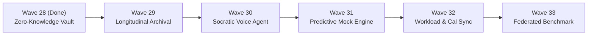

# HEX-AIM: Next 5 Waves Architectural Specification (Waves 29 – 33)

This specification defines the strategic, architectural, and pedagogical roadmap for **Waves 29 through 33**, completing the transformation of HEX-AIM into a closed-loop enterprise cognitive acceleration platform for UK British Curriculum primary students (Year 3–6).

---

## Strategic Horizon Overview

---

## Wave 29: Longitudinal Assessment Archival & Audit Dossier Engine (ADR-005)

### 1. Pedagogical Intent
Consolidates months of weekly micro-sprints and scanned assessments into tamper-evident, verifiable end-of-term student dossiers. Provides parents and schools with longitudinal growth curves, mastery delta trajectories, and standardized UK National Curriculum diagnostic benchmarks for parent-teacher conferences and SENCO reviews.

### 2. ADHD / Sensory Adaptation
Transforms fragmented anxiety-inducing scores into visual celebration milestones (mastered domains, zero-alarm victories, retention streaks). Protects working memory by summarizing historical cognitive trajectories in high-contrast visual infographics rather than dense grade tables.

### 3. Technical Architecture & Moats
- **Cryptographic Evidence Chain**: SHA-256 verifiable portfolio packager binding scanned images, OCR extracted text, Socratic hints, and graded mastery vectors.
- **Tiered Cold Storage**: Automated archival offloading from Upstash Redis hot keys to Cloudflare R2 / S3 cold buckets with pre-signed ephemeral download URLs (~1h TTL).
- **Multi-Page Vector Summary**: Generates 6-page A4 end-of-term summary PDF using Warm Browser Pool (<150ms latency) containing radar trends, subject breakdowns, and next-term intervention recommendations.

### 4. Implementation Deliverables
- `packages/core/src/archival/AssessmentArchiveEngine.ts`
- `packages/core/test/assessmentArchive.test.ts`
- Web Console: Tab 4 "Export Term 1 Cryptographic Dossier (PDF/ZIP)" modal.

---

## Wave 30: Real-Time Socratic Voice Dialogue & Oral Tutoring Agent

### 1. Pedagogical Intent
Enables low-friction, screen-free oral tutoring where the student or parent engages in direct two-way spoken Socratic dialogue with AIM. Converts passive reading into active vocal retrieval, which deepens long-term conceptual retention.

### 2. ADHD / Sensory Adaptation
Zero reading/screen fatigue. Specifically engineered for children with ADHD and Dyslexia traits who excel verbally but struggle with dense printed text. Built-in 3-minute spoken drill pacing with calm audio cues and zero-alarm praise feedback.

### 3. Technical Architecture & Moats
- **Low-Latency Audio Pipeline**: Client-side audio capture via Web Audio API, streamed directly to OpenRouter STT (`openai/gpt-4o-transcribe` / Whisper Turbo) with VAD (Voice Activity Detection).
- **Egyptian Arabic & English Dual Dialects**: Native support for Egyptian colloquial Arabic dialogue alongside English British Curriculum terminology.
- **Visual Waveform Oscilloscope**: Canvas-based real-time rotating scope-ring visualizer matching the Meta Astryx design language.

### 4. Implementation Deliverables
- `packages/core/src/voice/SocraticVoiceEngine.ts`
- `apps/web/src/ui/components/voiceDialogueModal.ts`
- `packages/core/test/socraticVoice.test.ts`

---

## Wave 31: Predictive Exam Readiness & Generative Mock Builder

### 1. Pedagogical Intent
Synthesizes personalized mock examination papers that mathematically target each student's active cognitive error clusters (`ERR_PHANTOM_ZERO`, `ERR_COLUMN_DRIFT`) and items approaching their cognitive decay half-life threshold ($R(t) < 0.75$).

### 2. ADHD / Sensory Adaptation
Predicts exam anxiety spikes before school test days. Generates calibrated, low-stakes practice drills with graduated question difficulty (starting with high-confidence wins, then scaffolding challenging multi-step questions) to cultivate psychological safety.

### 3. Technical Architecture & Moats
- **Isomorphic Question Synthesizer**: Generates novel question stems structurally equivalent to canonical exam boards (GL Assessment, Cambridge Primary, Edexcel) while altering contextual parameters to prevent superficial memorization.
- **Auto-Derived Rubric Vector**: Produces automated multi-tier mark schemes with partial-credit allocation rules and sensory scaffold suggestions.

### 4. Implementation Deliverables
- `packages/core/src/simulation/GenerativeMockEngine.ts`
- `apps/web/src/ui/examBuilderHtml.ts` (Dynamic `/exam/builder` route)
- `packages/core/test/generativeMock.test.ts`

---

## Wave 32: Intelligent Homework Balancer & Calendar Integration

### 1. Pedagogical Intent
Prevents academic burnout and cognitive overload by dynamically scheduling 8-minute micro-sprints around the family's real-world timetable, school assignment deadlines, and extracurricular sports/activities.

### 2. ADHD / Sensory Adaptation
Executive functioning prosthetic: breaks overwhelming weekly homework packets into manageable daily micro-sessions with calm, gentle reminders that eliminate domestic friction between parents and children.

### 3. Technical Architecture & Moats
- **Bi-Directional Calendar Engine**: Standard iCalendar (`.ics`) feed generation compatible with Apple Calendar, Google Calendar, and Microsoft Outlook.
- **Cognitive Load Leveling**: Heuristic scheduler preventing consecutive high-friction subjects (e.g. staggering Column Subtraction after a high-mastery verbal Science sprint).

### 4. Implementation Deliverables
- `packages/core/src/calendar/WorkloadBalancerEngine.ts`
- `apps/web/src/server.ts` (`/api/calendar/:studentId/feed.ics` endpoint)
- `packages/core/test/workloadBalancer.test.ts`

---

## Wave 33: Multi-School Federated Benchmark & Anonymized Cohort Exchange

### 1. Pedagogical Intent
Allows British Curriculum institutions in Cairo (Asten College, BISC, NCBIS, Cairo English School) to benchmark cohort mastery and error class distributions against peer schools without disclosing confidential institutional or student data.

### 2. ADHD / Sensory Adaptation
Destigmatizes neurodiverse learning needs by proving that sensory accommodation requirements (e.g. ADHD visual chunking, dyslexia room partitions) are widespread across top-performing cohorts.

### 3. Technical Architecture & Moats
- **Zero-Knowledge Differential Privacy**: Perturbs cohort averages using Laplace noise $\epsilon$-differential privacy, guaranteeing zero reconstruction of individual student performance.
- **Topological Mastery Comparison**: Ranks school cohort progress by curriculum graph depth rather than simplistic raw exam score percentages.

### 4. Implementation Deliverables
- `packages/core/src/institutional/FederatedBenchmarkEngine.ts`
- `apps/web/src/ui/teacherPortalHtml.ts` (Integrated "National Benchmark" tab)
- `packages/core/test/federatedBenchmark.test.ts`

---

## Dimension Comparison Matrix

| Wave | Core Module | Primary User | Pedagogical Impact | Technical Moat |
| :--- | :--- | :--- | :--- | :--- |
| **W29** | `AssessmentArchiveEngine` | Parents & SENCOs | Long-term growth verification | Tamper-evident SHA-256 PDF dossier |
| **W30** | `SocraticVoiceEngine` | Students (ADHD/Dyslexia) | Screen-free oral retrieval | Edge streaming VAD & bilingual STT |
| **W31** | `GenerativeMockEngine` | Students & Tutors | Anxiety-free targeted prep | Isomorphic question generation |
| **W32** | `WorkloadBalancerEngine` | Families | Executive functioning support | iCal calendar cognitive load leveling |
| **W33** | `FederatedBenchmarkEngine` | Headteachers & MIS | Macro-cohort accreditation | $\epsilon$-Differential Privacy aggregation |
