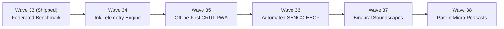

# HEX-AIM: Next 5 Waves Architectural Specification (Waves 34 – 38)
## Enterprise Cognitive Acceleration, Sensory Telemetry & Institutional Autonomy

This specification defines the strategic, architectural, and pedagogical roadmap for **Waves 34 through 38**, advancing HEX-AIM beyond diagnostic assessment and examination synthesis into real-time multi-modal telemetry, offline resilience, statutory SENCO compliance, physiological sensory regulation, and effortless home-school co-piloting.

---

## Strategic Horizon Overview

---

## Detailed Specifications by Wave

### Wave 34: Multi-Modal Ink & Dysgraphia Telemetry Engine (ADR-006)
- **Core Intent**: Bridges the divide between verbal mastery and physical paper-and-pencil execution by capturing real-time digital ink telemetry (stroke velocity, hesitation latency, pressure vectors, and column drift).
- **Target Neurodiversity**: Dysgraphia, spatial place-value disorganization, and digit/letter reversals (writing `03` for `30`, transposing `b`/`d`).
- **Core Moat**: WebGL/Canvas low-latency inking with "Ghost Ink" Socratic scaffolds that gently guide handwriting alignment without cognitive shame.

### Wave 35: Offline-First Edge PWA & Conflict-Free Replicated State (CRDT)
- **Core Intent**: Guarantees zero-interruption learning during school bus commutes, regional travel, and intermittent Egyptian internet throttles.
- **Target Neurodiversity**: Eliminates anxiety-inducing connection spinners, network timeouts, and lost sprint state.
- **Core Moat**: Local-first IndexedDB persistence using Yjs CRDTs, Service Worker Cache API bytecode caching, and Background Sync API replay queues.

### Wave 36: Automated SENCO EHCP Statutory Review & LA Audit Compiler
- **Core Intent**: Transforms months of granular cognitive micro-sprints and sensory pause telemetry into formal statutory evidence packs for UK Education, Health and Care Plan (EHCP) reviews and school inspections.
- **Target Neurodiversity**: Provides objective, longitudinal psychometric evidence protecting children with ADHD/Dyslexia from being mislabeled as "unfocused" or "unmotivated."
- **Core Moat**: Direct mapping of sprint metrics to UK SEND Code of Practice Section F statutory provisions, generating audit-proof A4 dossiers via Warm Browser Pool in under 3 minutes.

### Wave 37: Adaptive Cognitive Soundscapes & Binaural Sensory Regulation
- **Core Intent**: Modulates nervous system arousal and maintains ADHD hyper-focus during intensive procedural sprints using real-time Web Audio API procedural synthesis.
- **Target Neurodiversity**: Auditory distractibility, sensory under-arousal, and sprint transition anxiety.
- **Core Moat**: 100% zero-dependency client-side procedural synthesis of 40Hz gamma binaural beats, pink noise, and automatic cortisol-reducing frequency sweeps during sensory pause intervals.

### Wave 38: Autonomous Parent WhatsApp/Telegram Daily Podcast & Micro-CoPilot
- **Core Intent**: Closes the loop between the school day, student sprint practice, and the family dinner table through hyper-personalized 60-second audio debriefs.
- **Target Neurodiversity**: Replaces stressful parent "homework interrogations" with curiosity-driven conversational bridges.
- **Core Moat**: Automated neural TTS producing 60-second voice notes with dinner-table conversational prompts (bilingual Egyptian Arabic & English) and 1-tap interactive feedback buttons.

---

## Comprehensive Transposed Multi-Dimensional Comparison Matrix (Waves 34 – 38)

| Dimension | Wave 34: Multi-Modal Ink & Dysgraphia Telemetry (ADR-006) | Wave 35: Offline-First Edge PWA & CRDT State Sync | Wave 36: Automated SENCO EHCP Statutory Review Compiler | Wave 37: Adaptive Cognitive Soundscapes & Binaural Audio | Wave 38: Autonomous Parent Daily Podcast & Micro-CoPilot |
| :--- | :--- | :--- | :--- | :--- | :--- |
| **What** | WebGL/Canvas digital inking engine capturing stroke velocity, hesitation latency, pressure, and column alignment with ghost Socratic ink. | Local-first PWA architecture using IndexedDB and Yjs CRDTs with Background Sync API for 100% offline sprint execution. | Automated statutory evidence compiler generating formal UK SEND Section F annual review dossiers with longitudinal Ebbinghaus metrics. | In-browser procedural Web Audio engine generating 40Hz gamma binaural beats, pink noise, and cardiac-calming pause sweeps. | Asynchronous 60-second neural audio podcast ("School Run Brief") delivered via WhatsApp/Telegram with dinner conversational prompts. |
| **Why** | Neurodivergent children lose exam marks not from conceptual failure, but from spatial digit transposition and handwriting fatigue. | Egyptian home/school Wi-Fi instability and mobile throttling interrupt deep cognitive flow and trigger task abandonment. | SENCOs spend 15–20 hours per child manually collating fragmented paper notes to defend statutory funding and accommodations. | ADHD learners suffer from auditory distraction and sensory under-arousal, leading to restlessness during complex procedural tasks. | Parents feel disconnected from daily learning and interrogate children aggressively, creating domestic friction around homework. |
| **Why Now** | Approaching end-of-year physical paper assessments where handwriting speed and column layout dictate final grades. | Students taking tablets on school commutes and into offline classroom zones where continuous internet is unavailable. | Annual EHCP statutory review cycles require rigorous quantitative evidence to maintain school support allocations. | Transitioning to multi-step column arithmetic and dense scientific reasoning that require sustained 15-minute deep focus. | Working parents operate on tight schedules and do not log into web dashboards, requiring 60-second passive audio briefings. |
| **USP** | Ghost-ink Socratic visual guides providing non-judgmental spatial realignment + pre-error hesitation latency detection. | Conflict-free CRDT state reconciliation ensuring zero merge collisions and 100% data preservation across offline sessions. | One-click transformation of daily sprint telemetry into legally binding, LA-compliant statutory Section F provision proofs. | 100% procedurally synthesized audio with zero MP3 streaming latency; dynamically drops heart rate during 5m pause timers. | Frictionless 60-second voice note delivered directly to parent's messaging app with 1-tap interactive reaction buttons. |
| **Value Added to Vision** | Extends cognitive acceleration into the physical motor-spatial domain, ensuring conceptual mastery translates to paper exams. | Guarantees indestructible platform resilience, proving AIM functions seamlessly anywhere in the world without connectivity lock. | Establishes AIM as the indispensable compliance and legal intelligence infrastructure for school SENCO departments. | Elevates AIM into a physiological sensory regulation prosthetic, addressing the somatic foundations of attention and focus. | Transforms parents from anxious monitors into collaborative conversational partners at the family dinner table. |
| **Primary Target Persona** | Students with Dysgraphia / fine-motor delay, Occupational Therapists, and Math Teachers. | Commuting Students, Expat Families, and School IT Network Administrators. | School SENCOs, Inclusion Leads, Educational Psychologists, and Advocacy Parents. | ADHD Students with auditory distractibility and Sensory Occupational Therapists. | Working Parents, Busy Dual-Career Guardians, and Extended Family Mentors. |
| **ADHD / Sensory Scaffold** | Tactile-feel stroke smoothing, high-contrast column grid snapping, and zero-shame automatic correction guides. | Eliminates network timeout alarms, connection spinners, and lost-work panic (vital for ADHD emotional stability). | Validates neurodiverse learning differences with hard psychometric telemetry, preventing "lazy" characterizations. | Gentle acoustic cocoon that masks sharp domestic noises; automatic volume ducking during Socratic voice dialogue turns. | Replaces adversarial interrogation ("Did you do your homework?") with joyful conversational prompts ("Ask Lara about ice particles!"). |
| **Competition & Alternative Gap** | **GoodNotes / Notability**: Passive digital paper, zero pedagogical stroke analysis or spatial column error detection. **IXL / Century**: Typed input only, completely blind to handwriting motor failure. | **Century AI / Sparx**: Freeze instantly on connection drops; zero offline execution. **Duolingo**: Brittle offline mode, requires cloud ping to unlock subsequent learning modules. | **Edukey / Provision Map**: Manual teacher data entry forms; lack automated psychometric telemetry or decay graphs. **SIMS / ISAMS**: Administrative databases without neurodiverse sensory tracking. | **Brain.fm / Endel**: Generic adult focus audio, separate paid subscriptions, disconnected from pedagogical task states. **Standard EdTech**: Harsh gamified beeps/buzzers that trigger sensory overload. | **ClassDojo / Toddle**: Cluttered notification boards and generic announcements that parents ignore. **Parent Portal**: Dense web tables with delayed term grades that lack actionable advice. |
| **Technical Moat & Complexity** | WebGL Bezier smoothing, timestamped stroke vector calculation ($dx/dt, dy/dt$), dynamic column collision bounds. | Yjs state vector compaction, Service Worker Cache API bytecode caching, Background Sync API (`SyncManager`) replay. | UK SEND Code of Practice rubric mapping engine, longitudinal decay regression curves, Warm Browser Pool PDF compilation. | Web Audio API AudioContext graph with dual BiquadFilterNodes, StereoPannerNodes, and algorithmic pink/brown noise nodes. | Dynamic LLM synthesis of contextual dinner prompts, low-latency neural TTS synthesis (<800ms), WhatsApp Business webhook API. |
| **Primary Risks & Mitigations** | Stylus latency on low-end tablets $\to$ mitigated by client-side WebGL requestAnimationFrame loop with zero server dependency. | Local IndexedDB storage quota limits on shared iPads $\to$ mitigated by aggressive LRU eviction of old audio while preserving vectors. | Overly legalistic or clinical tone $\to$ mitigated by pedagogical humanization layer emphasizing child strengths and victories. | Sensory over-stimulation or sound aversion $\to$ mitigated by opt-in default, soft 3-second audio ramps, and frequency toggles. | WhatsApp notification fatigue $\to$ mitigated by strict 60s hard ceiling, customizable delivery schedules, and 1-tap pause. |
| **Time to Value** | Instantaneous tactile feedback on first stylus stroke. | Instant launch: sub-second cold start even in airplane mode. | Cuts annual EHCP review preparation from 18 hours to 3 minutes. | Instant focus: 1-tap activation with zero audio file downloads. | 60 seconds listening time during parent's morning or evening commute. |
| **Primary Success Metric** | $\ge 35\%$ reduction in spatial column errors and zero digit transpositions. | 100% sprint completion reliability across network disconnection events. | 100% acceptance rate by Local Authorities (LAs) without requests for re-testing. | $\ge 22\%$ increase in continuous on-task sprint completion duration. | $\ge 85\%$ daily parent listen-through rate and reported dinner engagement. |
| **Regulatory & Curriculum Compliance** | British Dyslexia Association (BDA) Classroom Tech Guidelines & UK Equality Act 2010. | Offline Data Protection by Design & Default (GDPR Art. 25). | UK SEND Code of Practice 2015 & Children and Families Act 2014 (Section F). | Sensory Processing Classroom Standards & Web Accessibility Guidelines. | GDPR Parental Communication Consent & Meta WhatsApp Business Policy. |
