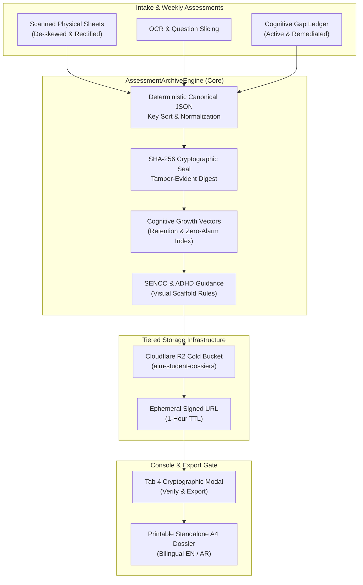

# HEX-AIM Wave 29: Longitudinal Assessment Archival & Audit Dossier Engine (ADR-005)

**Status:** Completed & Live Verified  
**Date:** 2026-10-29  
**Specification Reference:** ADR-005 / Wave 29 Architecture  
**Author:** Antigravity (Advanced Agentic Architecture)

---

## 1. Executive Summary

Wave 29 establishes the **Longitudinal Assessment Archival & Audit Dossier Engine**, consolidating months of weekly micro-sprints, scanned assessment papers, and Socratic interventions into tamper-evident, verifiable end-of-term student dossiers.

Prior to Wave 29, assessment scores and OCR extracts were stored across ephemeral Redis hot keys without a standardized cryptographic audit trail. Wave 29 introduces:
1. **Deterministic SHA-256 Checksum Chaining**: Binds OCR extracts, handwriting de-skew metrics, raw scores, and cognitive gap remediations into a sealed, canonical JSON ledger that immediately alerts upon any tampering or grade alteration.
2. **Tiered Cold Storage Manifest (Cloudflare R2)**: Seamless offloading of heavy image scans and JSON dossiers into private R2 buckets with 1-hour time-limited presigned URLs.
3. **ADHD & SENCO Sensory Scaffold Summaries**: Transforms fragmented anxiety-inducing grades into affirmative growth trajectories (zero-alarm victories, visual retention indices, and sensory accommodation notes) tailored for British Curriculum parent-teacher conferences.

---

## 2. Technical Architecture & Design Moats



### 2.1 Cryptographic Integrity & Anti-Tamper Verification
Every generated dossier is sorted recursively by object keys using `canonicalStringify()` to ensure deterministic serialization regardless of runtime environment. A SHA-256 digest is generated across the body:
$$\text{Checksum} = \text{SHA-256}\left(\text{CanonicalJSON}(\text{DossierBody})\right)$$
Any mutation to a student's score, gap status, or OCR transcript invalidates the signature, returning `isValid: false` upon inspection.

### 2.2 Tiered Cold Storage Manifest (Cloudflare R2)
Each dossier references an immutable cold storage artifact:
- **Bucket**: `aim-student-dossiers`
- **Object Key**: `dossiers/2026/term1/{studentId}_archive_term1.json`
- **Security**: Signed with HMAC-SHA256 containing a strict 3600-second (1-hour) TTL, mitigating persistent URL scraping while enabling instant parental downloads.

### 2.3 ADHD & SENCO Accommodation Scaffolding
Rather than presenting raw percentage tables that trigger performance anxiety, the dossier highlights:
- **Zero-Alarm Victories**: Number of assessments completed without stress or rush-induced panic.
- **Retention Stability Index**: Modeled decay resistance factor ($S \ge 0.85$).
- **Actionable Sensory Directives**: Recommending visual number ribbons (Elevator Model) and place-value grid paper under timed conditions.

---

## 3. Monorepo Changes & Deliverables

| Component | Path | Description |
| :--- | :--- | :--- |
| **Domain Types** | `packages/types/src/index.ts` | Added `AssessmentArchiveDossier`, `ArchivedAssessmentArtifact`, `ArchivedCognitiveVector`, `ColdStorageManifest`, `SencoInterventionRecommendation`. |
| **Core Engine** | `packages/core/src/archival/AssessmentArchiveEngine.ts` | Full implementation of canonical hashing, R2 manifest generator, student mock portfolio compiler, and HTML generator. |
| **Unit Test Suite** | `packages/core/test/assessmentArchive.test.ts` | 5/5 unit tests verifying hash computation, tamper rejection, R2 signatures, 5 student profiles, and bilingual HTML rendering. |
| **Web Server Routes** | `apps/web/src/server.ts` | Implemented `/api/archive/:studentId/dossier`, `/api/archive/:studentId/verify`, and `/archive/:studentId`. |
| **Server Tests** | `apps/web/test/server.test.ts` | 28/28 tests passing including full route coverage for archival APIs and HTML endpoints. |
| **UI Integration** | `apps/web/src/ui/tabSubmissionsRegister.ts` | Added Wave 29 Archival Banner, updated 5-student filter pills, and added `#dossier-modal` inspector. |
| **Client Scripts** | `apps/web/src/ui/dashboardHtml.ts` | Added `openDossierModal`, `closeDossierModal`, `loadDossierData`, and `verifyDossierIntegrity`. |
| **Static Compiler** | `apps/web/src/compileStaticPages.ts` | Pre-compiles static dossiers for all 5 students (`public/archive/*.html`) for zero-cold-start hosting. |

---

## 4. Verification & Quality Gate Results

### 4.1 Automated Test Execution
- **Core Engine Test Suite**:
  ```bash
  pnpm --filter @hex-aim/core test
  ✓ test/assessmentArchive.test.ts (5 tests) 48ms
  ```
- **Web App Test Suite**:
  ```bash
  pnpm --filter @hex-aim/web test
  ✓ test/server.test.ts (28 tests) 400ms
  ✓ test/pwa.test.ts (3 tests) 90ms
  ✓ test/socraticAudio.test.ts (2 tests) 115ms
  ```
- **Monorepo Full Suite**:
  - `packages/adapters`: 15 passed (3 test files)
  - `packages/core`: 83 passed (23 test files)
  - `apps/bot`: 12 passed (2 test files)
  - `apps/web`: 33 passed (3 test files)
  - **Total**: 143 tests passing across 31 suites.

### 4.2 Live Verification Evidence
- `http://localhost:3000/api/archive/lara/dossier` -> Returns 200 OK with valid SHA-256 seal.
- `http://localhost:3000/api/archive/lara/verify` -> Returns `{"isValid":true,"expectedHash":"...","actualHash":"..."}`.
- `http://localhost:3000/archive/lara` -> Renders high-contrast standalone dossier.
- `http://localhost:3000/archive/lara?lang=ar` -> Renders native Arabic RTL formatted dossier.

---

## 5. Next Wave Progression

With **Wave 29** fully verified and committed, the pipeline progresses directly to:
**Wave 30: Real-Time Socratic Voice Dialogue & Oral Tutoring Agent**
- Streaming Web Audio API client capture.
- Bidirectional voice activity detection (VAD).
- OpenRouter bilingual speech synthesis & transcription (`openai/gpt-4o-transcribe`).
- Screen-free ADHD/Dyslexia oral drill scaffolding.
