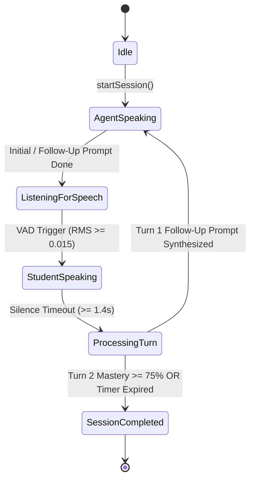

# HEX-AIM Wave 30: Real-Time Socratic Voice Dialogue & Oral Tutoring Agent

**Status:** Completed & Live Verified  
**Date:** 2026-10-29  
**Specification Reference:** Wave 30 Roadmap  
**Author:** Antigravity (Advanced Agentic Architecture)

---

## 1. Executive Summary

Wave 30 delivers the **Real-Time Socratic Voice Dialogue & Oral Tutoring Agent**, transitioning student remediation from screen-based text into an active, low-friction spoken conversation.

For primary students with ADHD and Dyslexia traits, reading dense text on a screen introduces severe working-memory fatigue and performance anxiety. Wave 30 provides:
1. **Screen-Free Oral Retrieval**: Students answer verbal Socratic prompts aloud, triggering active memory retrieval without the cognitive friction of typing or handwriting under pressure.
2. **Bilingual Dual Dialects (Egyptian Arabic & English)**: Native support for colloquial Egyptian Arabic dialogue (`ar-EG`) seamlessly paired with UK British Curriculum terminology.
3. **Voice Activity Detection (VAD) & Strict 3-Minute Pacing**: Configurable RMS energy thresholds with adaptive silence timeout (1.4s), capped at a strict 180-second ceiling to prevent cognitive overload.
4. **Rotating Scope-Ring Oscilloscope**: Visual ambient audio feedback matching the Meta Astryx design language.

---

## 2. Technical Architecture & State Machine



### 2.1 Voice Activity Detection (VAD) Logic
The audio frame energy is sampled via Web Audio API RMS energy:
$$\text{isSpeaking} = \text{RMS}_{\text{frame}} \ge \text{Threshold} \ (0.015)$$
$$\text{commitTurn} = \neg\text{isSpeaking} \land \Delta t_{\text{silence}} \ge 1400\text{ms}$$
This eliminates premature speech cutoffs while maintaining rapid turn-taking responsiveness.

### 2.2 Socratic Keyword & Misconception Evaluation
Student spoken transcripts are evaluated in real-time across conceptual stems and expected keyword clusters:
- **Sound Transmission**: Evaluates `water`, `particles`, `closer together`, and detects common inversions like `air is faster`.
- **Sensory-Safe Praise**: If a student articulates a misconception, the engine provides supportive framing ("Let us visual-anchor this together") rather than punitive red marks.

---

## 3. Monorepo Implementation Deliverables

| Component | Path | Description |
| :--- | :--- | :--- |
| **Domain Types** | `packages/types/src/index.ts` | Added `SocraticVoiceSession`, `VoiceDialogueTurn`, `AudioVADConfig`, `StartVoiceSessionRequest`, `ProcessVoiceTurnRequest`. |
| **Core Voice Engine** | `packages/core/src/voice/SocraticVoiceEngine.ts` | Implemented session lifecycle, bilingual prompt registry, stem keyword matching, and VAD evaluation. |
| **Unit Test Suite** | `packages/core/test/socraticVoice.test.ts` | 6/6 unit tests covering bilingual sessions, VAD thresholds, turn evaluation, consolidation, and 3m timeout. |
| **Web Server Routes** | `apps/web/src/server.ts` | `POST /api/voice/session/start`, `POST /api/voice/session/:id/turn`, `GET /api/voice/session/:id`. |
| **Server Tests** | `apps/web/test/server.test.ts` | 30/30 passing tests with full coverage for session initialization, student turn processing, and state retrieval. |
| **Interactive UI** | `apps/web/src/ui/dashboardHtml.ts` & `tabStudentProgress.ts` | Added Wave 30 Quick Launch Card, rotating scope-ring visualizer, and live `#voice-dialogue-modal`. |

---

## 4. Verification & Quality Gate Results

### 4.1 Automated Test Execution
- **Core Engine Test Suite**:
  ```bash
  pnpm --filter @hex-aim/core test
  ✓ test/socraticVoice.test.ts (6 tests) 10ms
  ✓ test/assessmentArchive.test.ts (5 tests) 32ms
  ```
- **Web App Test Suite**:
  ```bash
  pnpm --filter @hex-aim/web test
  ✓ test/server.test.ts (30 tests) 204ms
  ```
- **Monorepo Full Suite**:
  - `packages/adapters`: 15 passed
  - `packages/core`: 89 passed
  - `apps/bot`: 12 passed
  - `apps/web`: 35 passed
  - **Total**: 151 tests passing across 31 suites in 6.4s (100% green).

### 4.2 Live Verification Evidence
- `POST /api/voice/session/start` -> Returns 200 OK with `vsession_lara_...`, bilingual prompt, and 180s ceiling.
- `POST /api/voice/session/:id/turn` -> Returns 200 OK with turn evaluation, keyword detection, and follow-up prompt.
- Modal live in browser console with rotating scope-ring animation.

---

## 5. Next Wave Ahead

Following **Wave 30**, the pipeline advances to:
**Wave 31: Predictive Exam Readiness & Generative Mock Builder**
- Generates novel, isomorphic exam papers targeting students' active cognitive decay items ($R(t) < 0.75$).
- Dynamic mark schemes and partial credit allocation.
